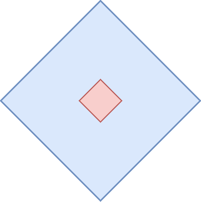
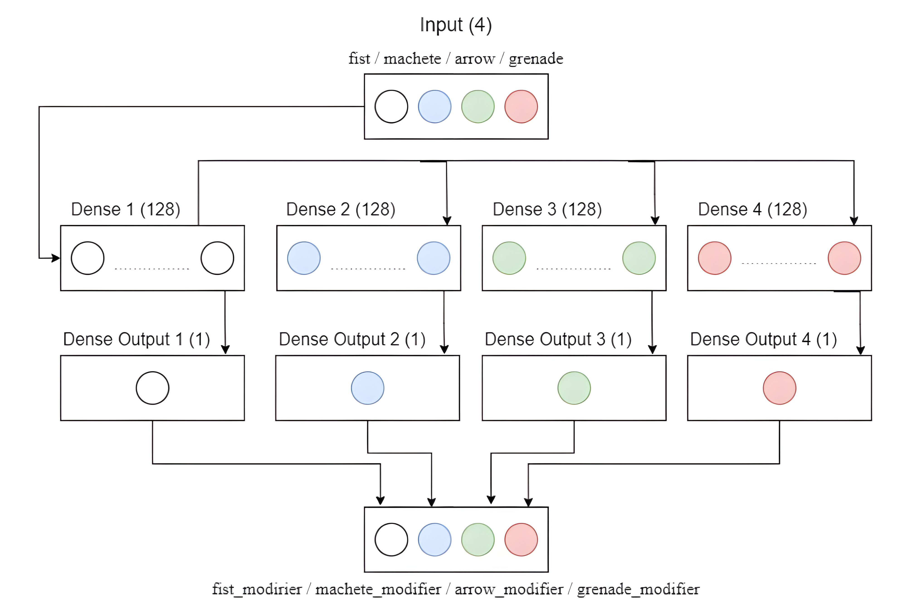
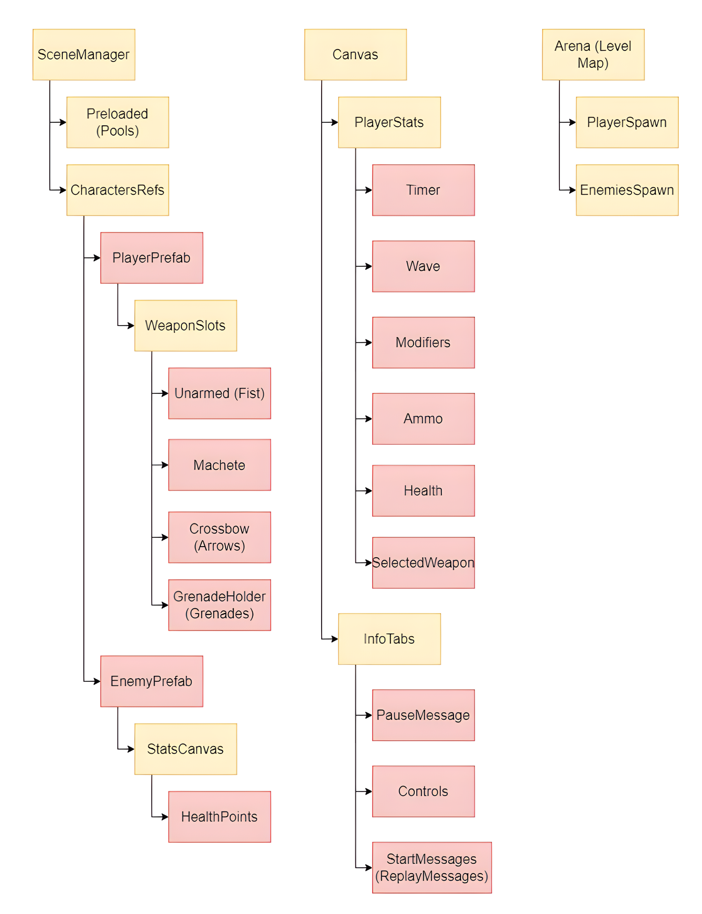
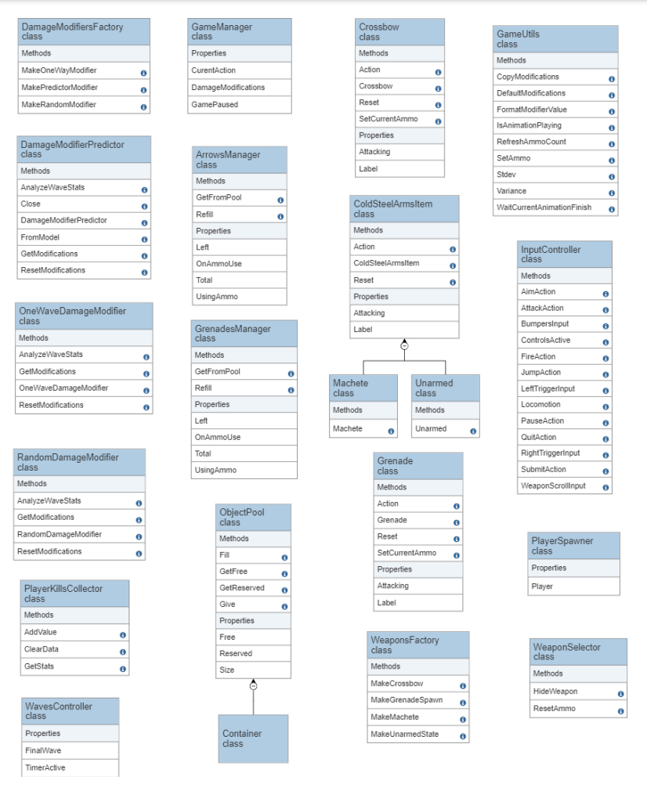
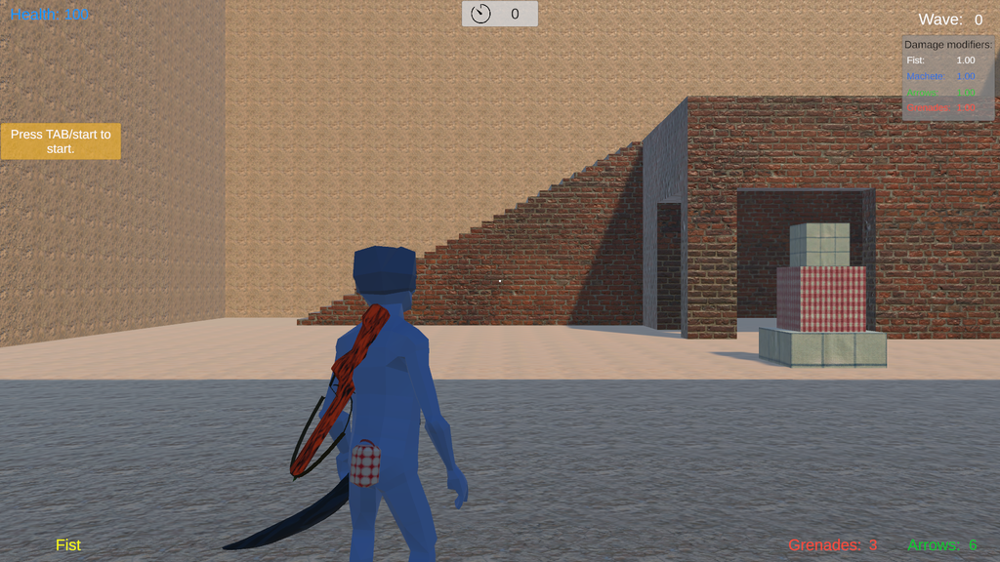
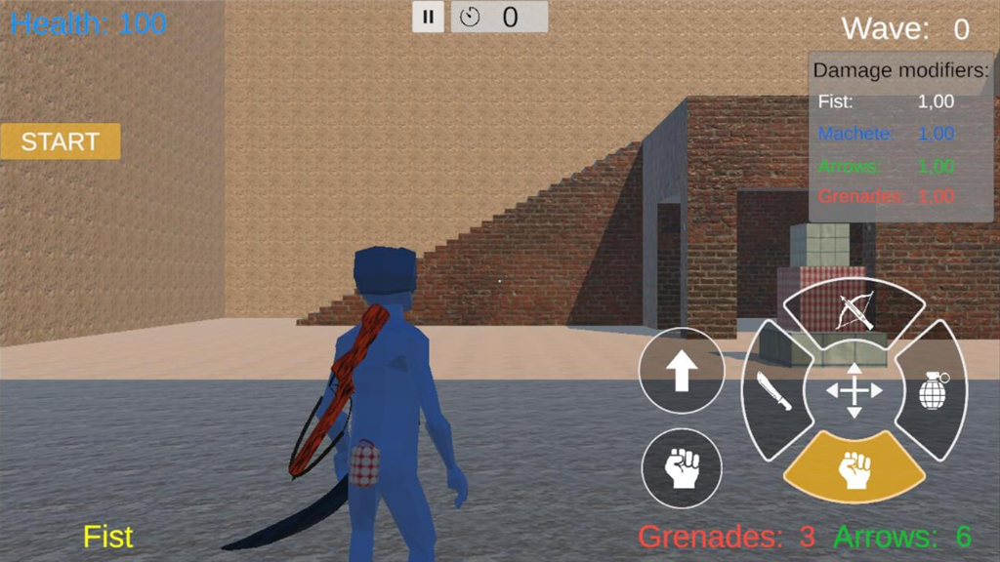
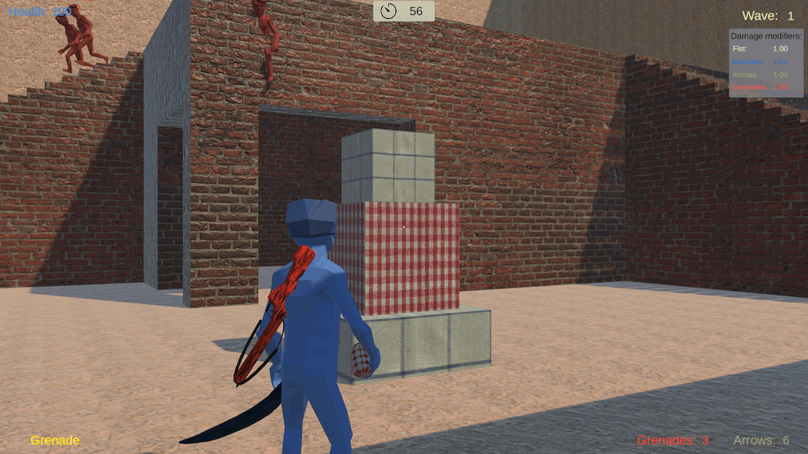
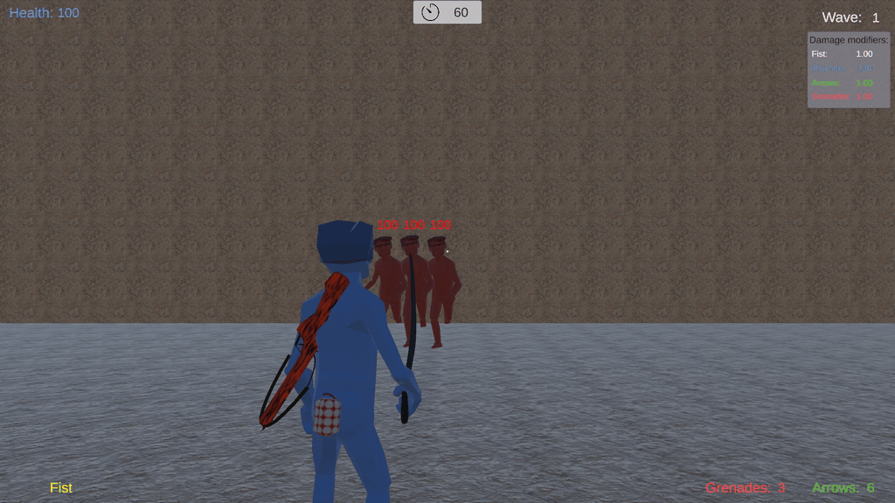
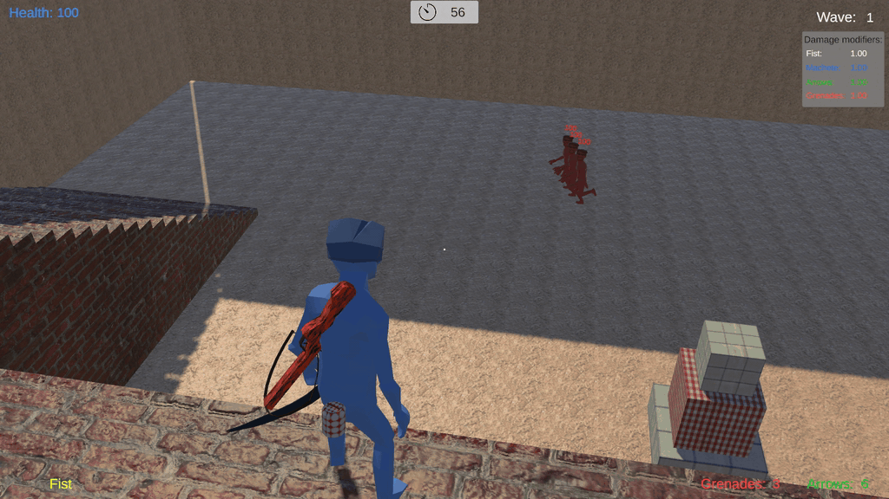

# Reactivation

<p align="center">
  <a href="https://andrew1407.github.io/Reactivation/">
    
  </a>
</p>

[](https://unity.com)
[](https://github.com/Andrew1407/Reactivation/releases)
[](https://github.com/andrew1407/Reactivation/actions/workflows/main.yml)
[](https://github.com/andrew1407/Reactivation/actions/workflows/pages.yml)

## Description

A third-person shooter made with Unity. The game collects player's metrics (during gameplay) to affect on weapon damage modifiers based on their play style, strategy (activity of usage). The project uses Unity's **Inference Engine** (formerly Barracuda) to load a runtime model of ONNX format to operate input/output data (gather and predict values). It is a practical part of the **[bachelor's work](https://ela.kpi.ua/items/f57022f0-be84-4b3d-aa0e-f38f550e1ee1)**.

Neural network model architecture (**[here's](/NeuralNetwork/damage_modifiers.ipynb)** a Python notebook):



Scene objects nesting structure on the main map (level):



Class diagram for main clases in the project:



## Gameplay











## Testing

Edit mode tests cover the gameplay logic (damage modifiers, kill stats, waves and timer, health, the object pool, camera input, stuck ammo) and the touch controls' input; play mode tests load the main scene, check the player spawns and the touch controls stay out of a desktop game, and drive the touch gestures. Run them from **Window → General → Test Runner** or headless:

```
Unity -batchmode -projectPath . -runTests -testPlatform EditMode -testResults editmode.xml
Unity -batchmode -projectPath . -runTests -testPlatform PlayMode -testResults playmode.xml
```

## Building locally

Use the **Build** menu in the editor, or [build.ps1](build.ps1) to build with the project's Unity version in batch mode and zip the results into `Builds/` (close the project in the editor first):

```
./build.ps1                                        # Windows + WebGL
./build.ps1 -Platforms Windows,Linux,macOS,WebGL,Android,iOS   # every platform whose build support module is installed
```

The web build runs on WebGPU where the browser supports it and falls back to WebGL 2 otherwise; serve `Builds/WebGL` over HTTP (opening `index.html` from disk won't load it).

Android builds an APK signed with the debug key; iOS builds an Xcode project to finish on a Mac.

## Touch controls

Phones and tablets, in the Android and iOS apps and in a mobile browser alike, start on on-screen controls: a stick that appears under the thumb held on the lower left to move, a drag elsewhere to look, jump and attack buttons, a pause button by the timer and a weapon ring to tap or swipe, with the HUD text enlarged to read on a small screen. Using a gamepad hides them while the text stays enlarged, and touching the screen brings them back.
